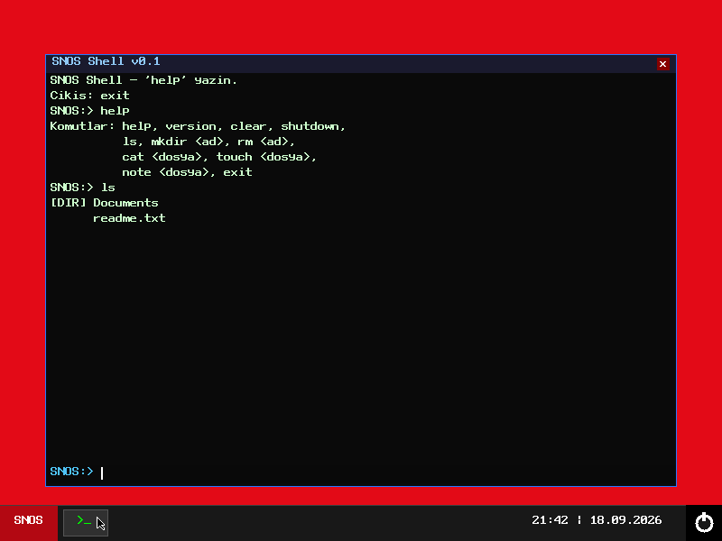

# SNOS

**English** | [Türkçe](README.tr.md)

| Desktop | Terminal |
|---|---|
|  |  |

A hobby bare-metal operating system for the 32-bit x86 architecture, written from
scratch. It is developed in freestanding C++ and Assembly without any existing
kernel or standard library.

> Status: **v0.1** — early development, an educational project.

## Features

- **Multiboot-compliant boot** — loaded by Limine (ISO) or GRUB, requests an
  800×600×32 graphics mode
- **CPU setup** — GDT, IDT, interrupt service routines (ISR) and PIC configuration
- **Memory management**
  - Bitmap-based physical memory manager (4 KB frames, built from the Multiboot memory map)
  - First-fit kernel heap (32 MB)
- **Drivers** — VESA framebuffer, PS/2 keyboard, PS/2 mouse, RTC (real-time clock)
- **Graphical interface** — framebuffer drawing layer, bitmap font, mouse cursor,
  a desktop with a taskbar and clock, log console
- **RAM disk file system** — create and delete files and folders in memory
- **Applications**
  - **Terminal** — `help`, `version`, `clear`, `ls`, `mkdir`, `touch`, `rm`,
    `cat`, `note`, `shutdown`, `exit` commands
  - **SNOS Note** — a simple text editor for files on the RAM disk

## Tech Stack

- **C++17** (freestanding, `-fno-exceptions -fno-rtti`) — the entire kernel
- **NASM Assembly** — Multiboot entry point and interrupt stubs
- **i686-elf cross compiler** (GCC/LD) and a custom linker script
- **Makefile** — building, ISO creation and running
- **Limine / GRUB** — bootloader
- **QEMU** — test environment

## Project Structure

```
boot/          Multiboot header and entry point (boot.asm)
kernel/        Kernel source code
  memory/      Physical memory manager and heap
  drivers/     VESA, keyboard, mouse, RTC drivers
  gui/         Framebuffer, font, cursor, desktop, log console
  fs/          RAM disk file system
  apps/        Terminal and SNOS Note
include/       Freestanding headers (stdint, string, io, multiboot)
grub/          GRUB configuration
iso_root/      Temporary directory for the ISO image (created by make iso)
linker.ld      Linker script
```

## Building and Running

Requirements (on Windows via MSYS2):

```bash
pacman -S mingw-w64-i686-cross-i686-elf-gcc nasm xorriso qemu
```

```bash
make          # builds the kernel (build/snos.elf)
make iso      # creates a bootable ISO with Limine (build/snos.iso)
make run      # runs the ISO in QEMU
make clean    # removes build output
```

The resulting `build/snos.iso` image can be run in virtual machines such as QEMU
or VirtualBox (Legacy BIOS mode).

### Usage

| Where | Exit |
|---|---|
| Terminal | type `exit` and press Enter |
| SNOS Note | `Ctrl + Q` (save with `Ctrl + S`) |

## Motivation

This is a personal project aimed at understanding how an operating system works at
the lowest level — from the moment the computer powers on — and at building
low-level systems programming skills.
